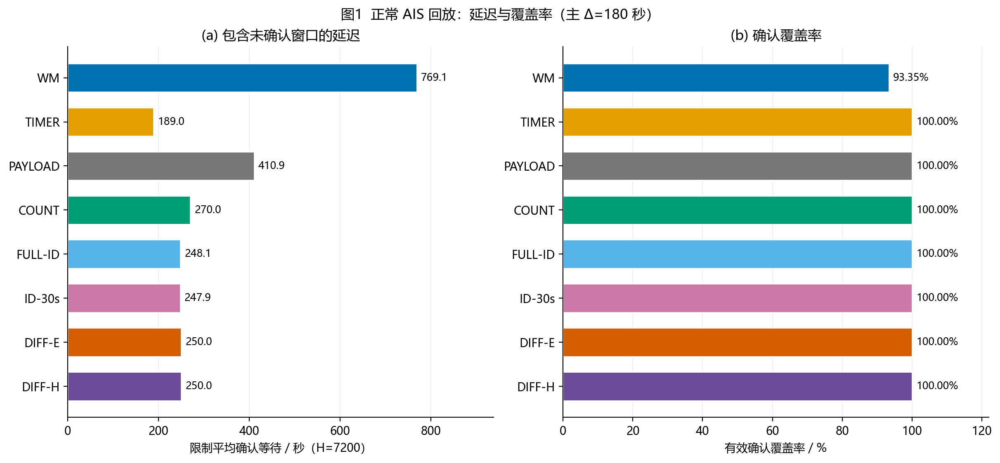

# 多源 AIS 去重计数提前确认

**GitHub仓库链接：[待填写]**

基于窗口SEAL、连续序号ACK、基数上下界与集合覆盖校验，在不等待全部轨迹报文时确认COUNT(DISTINCT mmsi)。代码区分“数值已确定”和“身份已恢复”，封闭日志内合法迟到身份不重复计数。

[完整研究报告](docs/完整研究报告.md) · [复现说明](REPRODUCIBILITY.md) · [数据与许可](DATA_AND_LICENSES.md) · [848项结果](results/run_summary.csv)



历史848项运行与38项测试已完成；正式结果由842项原结果及6项修复替代组成。正常回放DIFF-E相对COUNT平均限制等待269.961→250.046秒；完整身份清单和30秒身份流仍略快、通信更多。Bloom路径在冻结矩阵中没有被选中，不声称压缩成功。源封闭违约、控制丢包、缺SEAL及全源采集盲区负结果全部保留。

本地打包目录已通过38项测试、8组smoke、72份轨迹字节等价与9图重画核对，详见artifacts/package_validation.json；完整848矩阵没有在打包目录再次运行。当前只是本地仓库草案，未创建或推送GitHub远程。

## 目录

```text
analysis/              从摘要和公开作图表重画9组图
docs/                  完整七部分研究报告
experiments/           冻结配置、848行矩阵、Python协议和测试
AIS漏计风险预实验/     固定公开样本、57个原文件及失败分析
results/               运行级/日期级汇总、配对差值、逐run哈希
figures/               PNG/PDF/SVG与图注
artifacts/             源码版本、修复与验证记录
```

保留中文旧数据目录是为了保持冻结相对路径。无需外部AIS账号、数据库服务或流处理集群。原始848项逐包大日志未随普通Git树提供；下载链接在results/summary_manifest.json预留。小样本与摘要已随草案本地提供。

仓库作者/机构、代码许可证、正式仓库地址、原始日志归档地址：[待填写]。上游样本来源与原许可文本保持；不为用户虚构作者或许可证。

.gitattributes保留冻结文件换行字节；不要批量格式化受保护历史文件后继续使用旧哈希。
