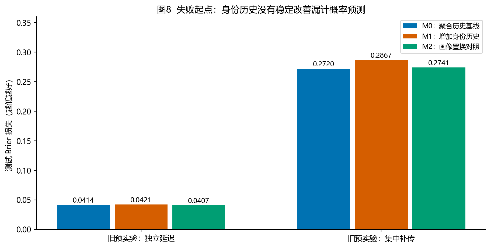
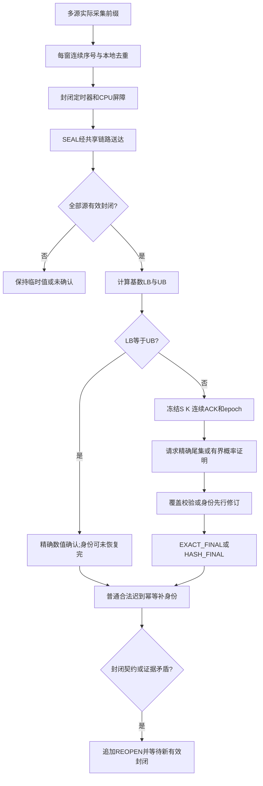
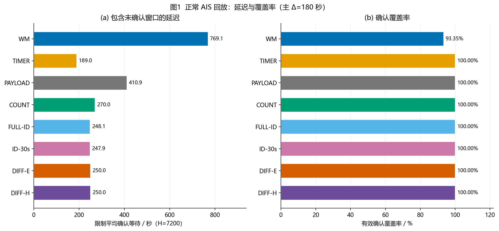
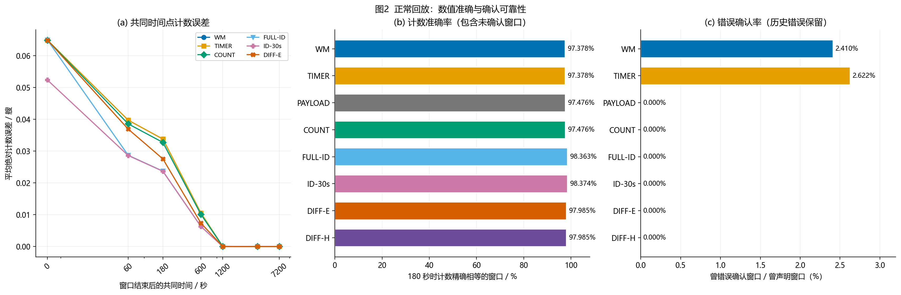
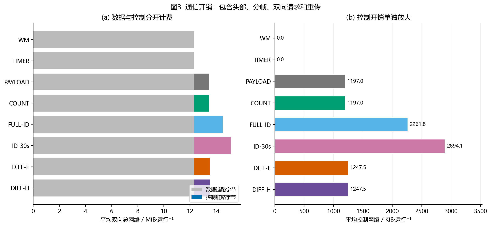
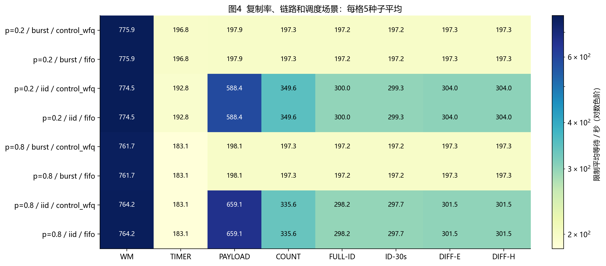
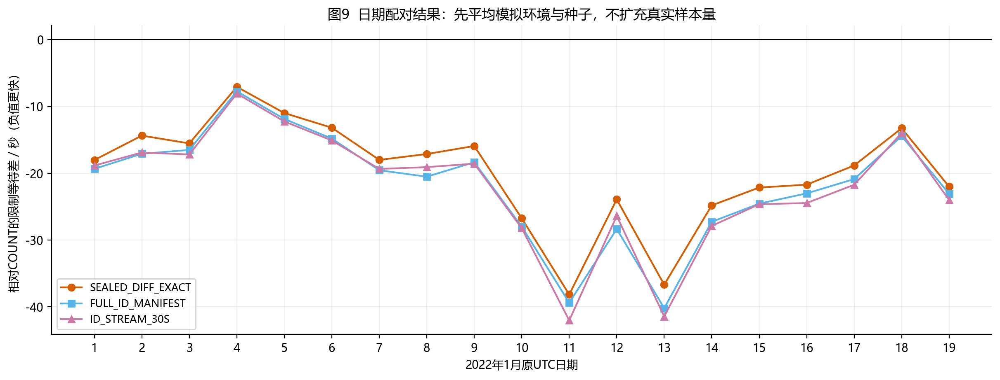
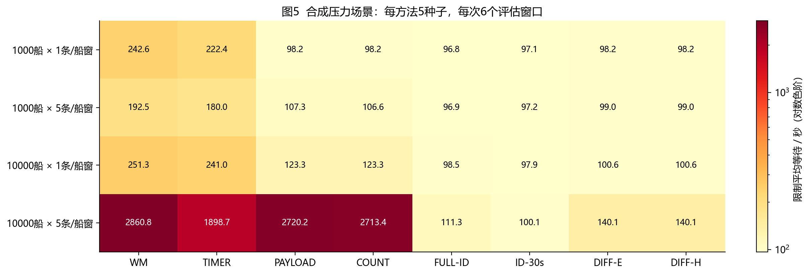
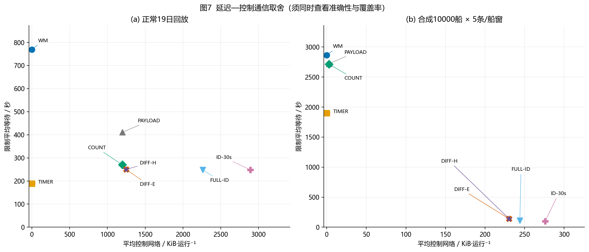
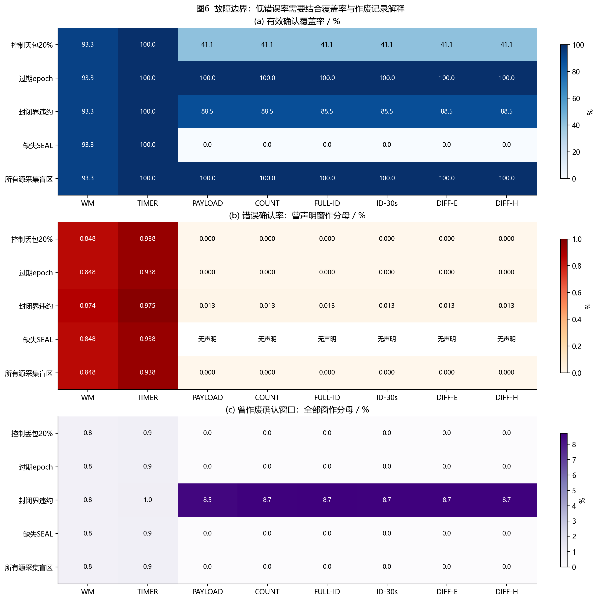

# 基于窗口封闭信号与集合差异校验的多源 AIS 去重计数提前确认机制

## 完整技术研究报告：研究背景—问题发现—方案推导—方法设计—实验验证—结果分析—总结

**材料状态：** 基于实际Python代码、冻结848项配置、六项基线修复重跑、38项测试和既有失败预实验整理。属于小样本回放与模拟系统研究，不是独立真实接收站部署评估。所有负结果、未确认和违约记录保留。**GitHub仓库链接：[待填写]**。图表、数据表、代码版本与证据索引随文提供；外部文献经助手打开核对，尚无投稿作者/人工终审记录。

**摘要。** AIS窗口去重计数的最终正确性取决于尚未计入的船舶身份，报文迟到率不能直接表示distinct漏计风险。本研究从历史风险预测失准出发，将问题重述为：在不等待全部轨迹报文的前提下，能否根据明确的上游窗口封闭承诺与身份覆盖证据，提前确认COUNT(DISTINCT mmsi)？实现采用登记源SEAL、连续序号ACK、基数上下界和精确尾集校验，并提供按实际字节选择的Bloom/独立指纹路径。正常回放中，精确差异版相对上游计数基线的限制平均等待由269.961秒降至250.046秒；高积压合成场景由2713.382秒降至140.098秒。完整身份清单和周期身份流仍有更低延迟，通信也更多。冻结矩阵没有选中哈希确认路径，因此未证明Bloom压缩收益。缺SEAL、封闭界违约与全源采集盲区分别揭示可用性、承诺可信性和观测范围的限制。〔E1—E4〕

## 一、研究背景

### 1.1 AIS业务目标与迟到语义

设事件时间窗口为W=[s,b)，目标查询为该窗口登记采集源记录并集中的不同MMSI数量。一个船舶可以产生多条报文，同一报文也可能由多个接收源捕获。因此，报文总数、各源船数之和与跨源去重船数不同。迟到报文是否改变结果，需要判断其身份是否已经计入。

水位线用于表达事件时间进度和预期的时间完备性。已有研究讨论完美/启发式水位线以及完备性标记，不能把“所有水位线都只能依赖经验Δ”作为本文前提。[Watermarks in Stream Processing Systems](https://www.vldb.org/pvldb/vol14/p3135-begoli.pdf)提供了这一语义背景。Flink的官方实现资料说明多输入水位线取活动输入的最小值，并支持空闲输入排除：[Generating Watermarks](https://github.com/apache/flink/blob/master/docs/content/docs/dev/datastream/event-time/generating_watermarks.md)。〔E5、E6〕

本报告主要比较的是**代码中已实现的固定Δ水位线策略**，不是完整Flink/Dataflow性能测试。对该基线，

$$w_i(t)=\max_{r\in R_i(t)} e_r-\Delta,\qquad w(t)=\max_{\tau\le t}\min_{i\in A(\tau)}w_i(\tau).$$

其中R_i(t)是已到达记录，A(t)是当前活动源；本实验60秒无数据将源标为空闲，全部空闲时保持水位线，水位线不回退。它依据事件时间和固定容忍范围推进，不读取未到达记录的MMSI覆盖关系。本研究保留定时b+Δ发布基线，以防比较结果仅反映水位线被空窗口卡住。〔E1：coordinator.py〕

### 1.2 本研究保证的对象

必须区分四个对象：现实海域全部船舶、源实际采集到的记录、协调器收到的完整报文，以及协调器已经确定的统计值。现有公开教程样本没有完整真实接收站真值，所以本文目标是**登记源实际采集日志的并集**，不声称恢复现实中所有未被采集的船舶。

研究目标是有条件的提前确认：源封闭承诺成立、名单与查询范围正确、消息属于有效epoch时，对数值给出可追溯的最终声明。相比单纯提高平均预测准确率，这一目标允许明确说明哪些证据足够、哪些情况应保持未知，以及确认后来如何被证伪。

### 1.3 与本文固定Δ水位线基线的区别

| 维度 | 固定Δ水位线基线 | 本研究机制 |
| --- | --- | --- |
| 主要判断对象 | 事件时间是否已推进到窗口末端 | 目标COUNT DISTINCT是否已有充分证据确定 |
| 在线信息 | 已到达最大事件时间、Δ、空闲状态 | 有效SEAL、源基数、来源身份、连续ACK与集合证据 |
| 最终声明条件 | 活动源水位线越过b，属于启发式预期 | 全源封闭，且LB=UB或覆盖证据齐备 |
| 是否要求完整载荷 | 不直接检查载荷齐备，以时间规则代替等待 | 可在载荷未齐时确认，但证据和成本必须明确 |
| 身份尚未恢复完 | 没有单独的精确数值锚点证明 | 数值可精确确定，后续合法身份不重复加计数 |
| 适用查询 | 时间前沿可供多类算子使用 | 当前只实现只追加MMSI去重计数 |
| 额外代价 | 本基线不传SEAL或身份元数据 | 源状态、控制通信、快照、校验、版本和失效处理 |
| 保证边界 | 固定容忍范围可能被实际迟到打破 | 精确性依赖封闭/身份契约，概率路径另有摘要风险 |

这一比较不排斥已有系统把完备性标记或查询语义接入水位线。它说明当前代码增加了哪些信息和义务，不能被理解成“在完全相同信息下无成本击败所有水位线”。

## 二、问题发现

### 2.1 同样迟到一条报文，计数影响可以不同

设协调器已知身份集合为S，迟到报文身份为x，则其即时边际影响为

$$\Delta C(x\mid S)=\mathbf1\{x\notin S\}.$$

构造三个报文、相同事件时间和接收延迟的两种流：A流在截止前收到a、b，最后迟到a；B流在截止前收到a、a，最后迟到b。两流最终身份集合均为{a,b}，迟到比例均为1/3，报文延迟分布完全相同，但截止时A流漏计0、B流漏计1。固定Δ水位线可以在两流具有相同时间戳序列时作出相同时间决策，却不能仅由时间信息知道迟到报文的distinct贡献。

对全部潜在迟到记录，漏计量是

$$d(t)=|U_W\setminus S(t)|,$$

而不是迟到报文条数。重复报文之间还会共享身份，所以逐报文影响不能不加去重地相加。这个反例证明问题真实存在，但不等于证明本文方案已经具有排他的新颖性。

### 2.2 历史预测预实验为什么失败

最初的思路是利用历史出现频率、报文间隔等信息预测未见船舶风险。原预实验保留的五种子平均Brier损失为：独立延迟M0/M1/M2约0.041362/0.042127/0.040722；集中补传约0.272048/0.286698/0.274052。M1增加身份相关历史后没有稳定改善。M0本身含聚合历史，M2保留画像总体结构，所以该结果不能推出“全部历史信息都无价值”。〔E4〕



**图注。** 来自原固定C模型、五种子平均测试Brier，不重新拟合或调参。它是848项协议实验之前的另一任务和模拟器，不能把Brier与本报告计数误差直接横向比较。M0本身已经含聚合历史，M2也不是完全无历史。


原样本2022-01-17 17:55:28至01-18 13:37:22之间已有70914秒记录空档，完全位于空档内的117个测试窗口在模拟前就是空窗。source_time_lag=发布时刻−已到达记录中的最新源时间，最大70652秒是**记录陈旧程度**；单条补传报文最大延迟仅约1220.8—1226.5秒。这两个量不是同一变量。

集中补传的117个空窗占测试窗口20.31%，却贡献约74.59%的M0 Brier损失；模型把多数空窗判为接近100%漏计。在459个非空窗口上M1仍更差，不能删除空窗后宣称成功。输入支持范围变化、稀疏历史和有限样本拟合共同影响结果；没有通过反复调参制造改善。上述分层是事后诊断，原失败结果及57个受保护文件保持不变。〔E4〕

### 2.3 从预测问题转为证据问题

只有相同接收前缀时，可以存在两个世界：H0中窗口本来没有其他源记录；H1中另有身份b的记录仍在上游。任何只读该前缀的确定函数都会给出相同输出，因此无法在两个世界都作出绝对正确的完整性判断。历史可以提供概率先验，但不会自动消除这个不可识别性。

心跳说明源存活，积压条数说明有多少记录待传；它们都不说明待传身份是否已被别的源计入。本研究因此增加两类信息：**上游声明窗口日志已封闭**，以及**封闭日志相对已知身份的覆盖证据**。这不是从同一观测前缀“预测出真值”，而是明确增加了可验证承诺及其成本。

## 三、方案推导

### 3.1 定义、假设与四种完整性

令源名单I={1,…,m}在每个窗口和查询版本固定。源i的封闭日志为L_i(W)，末序号h_i，身份集合U_i，局部去重数n_i=|U_i|。全局目标为

$$U_W=\bigcup_{i=1}^m U_i,\qquad N_W=|U_W|.$$

协调器K_i(t)只包含精确知道来自源i的身份；S(t)=∪K_i(t)。来源精确清单也可增加K_i，但概率覆盖证明不能写入K_i。计数采用只追加语义，不处理删除、历史身份替换或MMSI纠错。

| 完整性层次 | 本文中的含义 | 不能混淆的事项 |
| --- | --- | --- |
| 采集范围完整 | 目标仅覆盖登记源实际采集日志 | 不是现实海域完整观测 |
| 报文完整 | 每源1…h_i均已到达 | 比distinct确认所需条件更强 |
| 身份完整 | U_W⊆S | 不必等待同身份的全部轨迹报文 |
| 数值可确定 | 所有兼容证据给出同一个N_W | 可以尚未恢复全部身份 |

源和采集时钟承诺被信任，网络可以乱序、断网、丢控制包、重传，但不模拟恶意源伪造身份或基数。标识采用uint32；本地封闭界为采集滞后≤30秒、时钟偏差0。若这些契约不成立，精确保证可能失效，故障实验会直接检验这一点。〔E1、E3〕

### 3.2 第一层证据：窗口SEAL

SEAL绑定(source,window,query,roster_version,epoch)，携带(h_i,n_i,capture_frontier)。源在b+30秒定时器触发后，先等待此前采集CPU作业完成，再从当时已采集的本地日志生成SEAL；不是从完整未来表groupby后假装提前发送。空源必须明确发送h_i=n_i=0；没有SEAL始终为未知。

SEAL可以先于某些旧报文到达，所以它不直接证明报文齐备。它声明目标日志的范围已经固定，随后才能谈遗漏身份是否会改变查询结果。它与传统完备性标记有关，**不把源封闭信号本身称为新发明**。如所有源SEAL都未齐，本协议不作全局精确最终声明。

### 3.3 第二层证据：基数上下界

全部有效SEAL到齐，且K_i⊆U_i时，可计算

$$\boxed{LB=\max\bigl(|S|,\max_i n_i\bigr)},\qquad
\boxed{UB=|S|+\sum_i(n_i-|K_i|)}.$$

**下界证明。** U_W包含S，也包含每个U_i，因此N_W≥|S|且N_W≥n_i。

**上界证明。** 任意U_W中尚未在S出现的身份，必属于某个U_i\K_i，故新身份总数不超过这些差集大小之和。于是N_W≤|S|+Σ(n_i−|K_i|)。

在大标识域、没有额外否定成员信息时，两端也能通过填充共同/互异身份达到；实现前的有限穷举检查及当前随机排列测试覆盖了相应数值关系。若LB=UB，直接发布COUNT_EXACT；无需先知道全部MMSI。

例如K_1=K_2={a}，n_1=3，n_2=1，则LB=3、UB=1+(3−1)+(1−1)=3。此时|S|=1而N_W=3已经确定，后续身份b、c到达只恢复身份，不增加3。反之，仅知道n_1=n_2=2、没有身份，全球并集可以为2、3或4，不能直接相加或假定完全重叠。〔E1：snapshots.py、coordinator.py；E3〕

这里已把快速路径公平提供给上游精确计数、完整身份清单、身份流和差异版本。本文不能通过削弱计数基线来制造收益。

### 3.4 第三层证据：连续序号与精确尾集

定义真实连续确认位置

$$a_i(t)=\max\{a:\{1,2,\ldots,a\}\text{的原始DATA均已收到}\}.$$

收到序号1和3时a_i=1，不能用max(seq)=3代替；否则可能把序号2的唯一新船排除。全部封闭后，冻结同一轮S_0、K_i^0、a_i^0和epoch。源返回

$$P_i=\{\operatorname{mmsi}(r):r\in L_i(W),\ \operatorname{seq}(r)>a_i^0\}.$$

于是

$$U_i\subseteq K_i^0\cup P_i.$$

理由是：不在尾部的记录序号≤a_i^0，已由连续ACK保证收到；尾部其余身份全部包含在P_i。若所有P_i⊆S_0，则全部身份已经计入；若存在

$$D_i=P_i\setminus S_0\ne\varnothing,$$

则精确身份元数据可以先修订S和计数，再确认，而不用等待完整轨迹载荷。来源的精确K同步补齐，后续同身份DATA幂等处理。

**实现边界必须说清。** 当前源只收到ACK和|S_0|，并不知道S_0的所有成员。源传输的是P_i的精确编码，协调器才计算真正的新身份。P_i不是“按未来到达时间筛出的未到集合”，也不等于最小差集U_i\S_0。序号早期有空洞时，P_i可很大，即便真实漏计d很小。标题中的“差异校验”是查询覆盖检查，当前精确版没有O(d)最优通信保证。〔E1：source.py、snapshots.py、wire.py〕

### 3.5 数值锚点及合法迟到修订

实现独立维护S、published_count和last_exact_numeric_anchor。精确数值确定后，新的有效身份到达必须先检查来源、epoch、序号和基数一致性；不能只因x∉S就判断错误确认。若源在有效封闭日志中早已包含该身份，数值可保持不变。

已经实测的smoke窗口从2022-01-06 12:30 UTC开始：协调器已收到3个不同身份，但通过上游基数确定计数4；后续首次收到MMSI 368173090时，结果保持4，没有REOPEN。单元测试还覆盖计数3、已知身份1、之后序号3和2乱序补齐的情况。〔E3〕

以下属于应作废的情况：DATA序号超过SEAL的h_i；源封闭后继续采集旧窗口并宣布新epoch；|K_i|>n_i；新的精确证据排除此前数值锚点。只追加模型下，作废的旧精确值仍可作为下界，临时值取max(anchor,|S|)，等待新的有效封闭。

### 3.6 Bloom与指纹的概率路径

若只把协调器S做Bloom，并以“所有待传身份查询均阳性”确认完整，新身份可能因假阳性被藏住。因此现实现由源构造**B(P_i)**，协调器在冻结S_0中重建候选

$$V_i=\{x\in S_0:B(P_i).contains(x)\}.$$

除要求|V_i|=|P_i|=m_i，还必须核对独立随机点r下的集合特征多项式值

$$F_r(A)=\prod_{x\in A}(r-x)\pmod p,\qquad p=2^{127}-1.$$

如果P_i≠V_i且基数相同，两个首一多项式相减最高项抵消，差多项式非零且次数≤m_i−1；r在有限域均匀、独立于已固定的集合和候选时，

$$\Pr[\text{错误接受}]\le\frac{\max(0,m_i-1)}p.$$

按窗口对实际接受证明求和管理预算，阈值10^−18。m=0直接精确，m>|S_0|直接回传精确身份；核验失败仅作一次精确回退，不重复换盐搜索。重传复用同一请求、快照、响应与随机点。概率覆盖单独标为HASH_FINAL，不能把候选V写入精确K“洗成”EXACT。实际代码使用命名空间分离的伪随机流和拒绝采样，保证依赖随机独立性模型；它不是恶意自适应输入下的无条件认证。

集合特征多项式、IBLT和Rateless IBLT均已有工作，本文只组合其适用原理，不主张发明这些原语。参考[Minsky等的集合对账作者资料](https://ipsit.bu.edu/documents/isit2001_short.pdf)、[IBLT](https://arxiv.org/abs/1101.2245)和[Practical Rateless Set Reconciliation](https://arxiv.org/abs/2402.02668)。后两类方法不是本次已经执行的对照。〔E7—E9〕

## 四、方法设计

### 4.1 在线流程和模块边界



SourceState不能读取协调器S、最终并集或未来网络到达时间；Coordinator不能读取源内部日志或oracle。仿真器可以事先排程采集和断网，但这些对象不传给协议。Evaluator在事件循环结束后读取真值。时间为整数微秒，同时事件固定按CAPTURE、NETWORK_RECEIVE、LOCAL_SEAL、PUBLISH、CHECK_DISPATCH、TIMEOUT排序。〔E1〕

| 模块 | 实际职责 |
| --- | --- |
| ingest / multisource | 固定输入读取、空间主源与次近源复制、采集时刻和故障排程 |
| source / snapshots | 已采集日志、SEAL、序号连续前缀、冻结请求和响应缓存 |
| coordinator / baselines | 数值锚点、上下界、查询覆盖证明、发布版本与迟到修订 |
| wire / network / engine | 实字节编码和原子重组、FIFO/WFQ共享链路、CPU与事件排程 |
| bloom / fingerprint | 候选构造、独立多项式核验、风险预算与精确回退 |
| evaluator / audit / runner | 事后指标、哈希与因果隔离审计、逐行冻结配置执行 |

### 4.2 公平的八组方法

| 缩写 | 实际ID与规则 | 是否含精确证据 |
| --- | --- | --- |
| WM | WM_DELTA；固定Δ活动源水位线，迟到仍修订 | 启发式 |
| TIMER | TIMER_DELTA；b+Δ声明，迟到仍修订 | 启发式 |
| PAYLOAD | PAYLOAD_BARRIER；SEAL齐且全部原始序号齐 | 精确 |
| COUNT | UPSTREAM_COUNT_ONLY；SEAL基数和共同LB/UB，继续等DATA | 精确 |
| FULL-ID | FULL_ID_MANIFEST；源封闭后完整身份清单，同时有基数快路 | 精确 |
| ID-30s | ID_STREAM_30S；首次本源身份每30秒批送，封闭冲刷 | 精确 |
| DIFF-E | SEALED_DIFF_EXACT；封闭门控、快路、精确尾集 | 精确 |
| DIFF-H | SEALED_DIFF_HASH；比较实际编码后选精确或哈希路径 | 精确或概率 |

WM/TIMER主Δ=180秒，并完整运行60/600/1200秒网格。所有方法在b首次发布PROVISIONAL，故首次发布延迟均为0；比较重点是**有效最终确认**，不能把本方法临时发布与基线最终发布混比。

COUNT是强基线，不把Σn_i当作全局distinct。FULL-ID收到快路证据也可提前确认，但按照冻结设计已经发出的清单仍收费。ID-30s检验收益是否仅来自“更早传身份”。本次没有实现Adaptive Watermarks、AQ-K-slack、IBLT或Rateless IBLT，不能据当前比较宣称优于这些方法。单个完整上游已掌握全局U，或源按身份严格不相交分区时，一个精确计数/整数求和就足够，本文复杂对账没有普遍必要性。

### 4.3 网络与计算的真实计费

每源双向合计4096B/s，数据和控制共享容量及断网。FIFO和控制/数据权重20:80、可借空闲份额的包级WFQ都运行。iid每包10%取240—1200秒延迟、否则0—20秒；burst每源小时20%概率发生1200秒不可发送期，起点偏移0—2400秒，普通传播0—20秒。控制包没有特权穿透断网。

默认DATA体128字节、公共头48字节、最大应用帧1200字节，每帧另计40字节模拟网络开销。MMSI为uint32，身份列表实际比较排序uint32与delta-varint；不是用CSV长度或对象大小估算。全部方向、分片、回退、重传都收费。比较候选编码即使未发送，其构造成本也收费。

源与协调器分别使用单CPU作业队列，采用开发合成键冻结的操作成本。报告同时保存真实进程CPU及墙钟耗时，但后者受并行执行影响，不作为方法效率排名。当前CPU模型没有覆盖所有Python控制流和事件堆细节，不能外推生产吞吐极限。〔E1、E2〕

### 4.4 贡献与创新边界

本研究可以强调的候选贡献是：第一，把AIS去重计数确认具体化为“封闭的目标日志＋身份覆盖或数值可确定性”，而不是以报文迟到率代替查询影响；第二，将报文完整、身份完整、数值可确定拆开，实现无需修订、数值先行修订、身份先行修订三类确认；第三，用一致链路计费及强基线检验何时额外证据值得传输；第四，以封闭违约和采集盲区给出明确反例和失效记录。

这些首先是**查询语义与系统协议的可检验设计贡献**。上下界、源完备性标记、概率集合摘要和集合对账都可能与已有通用方法重合，当前文献与实验不足以支持“首次提出”或新压缩算法的结论。若最终论文主张算法新颖性，还须与真正相关方法进行同任务、同证据能力的比较。

## 五、实验验证

### 5.1 数据、模拟与证据范围

公开样本来自AISdb-Tutorials固定提交bb978e03a8469184e421cec8927aae49aacfe8c7。原SQLite 40000行；评估段2022-01-01至01-19保留39828行、53个MMSI、2736个10分钟窗口。其中215个源样本空窗全部保留，含原失败测试集的117个连续空窗。3个后置保护窗口仅帮助末尾水位线推进，记录仍按实际模拟时刻到达，不纳入评估分母。〔E2、E4、E10〕

现有样本可提供MMSI、回放时间、经纬度与重复结构；数据库时间未验证为船舶真实发报时刻。真实接收源、接收时间、链路、封闭信号、序号与采集完备性均不能由它直接获得，必须明确模拟。四个虚拟源采用最近主源必采集、以p=0.2或0.8复制给次近源，单次采集滞后0—30秒；p不是集合重叠率。1000/10000船、每窗1/5条报文使用合成身份、位置和时间，只有系统负载含义。

### 5.2 冻结矩阵及实现修复

| 阶段 | 配置组成 | 实际运行配置数 |
| --- | --- | ---: |
| smoke | 2022-01-06，seed11，p=0.8，iid，FIFO，8方法主参数 | 8 |
| replay | 2复制率×2链路×2调度×5种子×14方法/Δ变体 | 560 |
| pressure | 4规模×5种子×8方法，burst、WFQ，每次6窗 | 160 |
| faults | 5故障×3种子×8方法，burst、WFQ | 120 |
| 合计 | 固定run_id清单 | **848** |

先完成精确版，再接入Bloom与指纹并运行矩阵。38项单元/属性测试中一项覆盖200组随机多源排列。源空、缺SEAL、跨源重复、序号空洞、分片乱序/丢失、快照和epoch、数值锚点、Bloom替换与小域碰撞均有实际测试。

执行中发现WM/TIMER虽没有发送SEAL，却在源内部设置sealed并在迟到采集后额外发REOPEN，影响违约故障的公平性。修复后重跑受影响的6个配置及全部8组smoke。最终848项汇总采用**842项原运行＋6项修复替代**；不是848项全部在新版本重新运行。修复前后8组smoke的72份协议/真值/窗口文件逐字节一致，两个代码版本和原始结果都保留。另有首轮Windows内存句柄类型错误、汇总器缺零控制字节列、并行运行拒绝覆盖正在写的目录等记录，均没有通过更换参数或删除负结果解决。〔E3〕

### 5.3 指标和分母

令\hat N_W(t)为实际发布值，N_W为事后采集真值。共同时间点h∈{0,60,180,600,1200,3600,7200}评价

$$MAE(h)=\frac1{n}\sum_W|\hat N_W(b+h)-N_W|,$$

$$Acc(h)=\frac1n\sum_W\mathbf1\{\hat N_W(b+h)=N_W\}.$$

准确率包含空窗口和未确认窗口，只表示数值相等，不自动表示有证明。错误确认率为

$$FCR=\frac{\#\{W:\text{曾作出错误数值最终声明}\}}{\#\{W:\text{曾作出最终声明}\}}.$$

若没有最终声明，FCR不可定义，不填0掩盖未知。另报曾作废确认窗/全部窗：计数恰好仍正确但封闭证明后来作废，与数值错误不是同一指标，二者可重叠。

有效确认时间要求声明计数等于最终采集真值且此后未被作废。此判断只由事后评估器使用。H=7200秒下的限制等待为

$$R_H=\frac1n\sum_W\begin{cases}t_W^{valid}-b_W,&t_W^{valid}\le b_W+H,\\H,&\text{截止H没有有效确认}.\end{cases}$$

因此未确认窗口不会被删去后只计算成功平均。P95不足覆盖率时标不可估计。全部通信按已传输网络字节统计，另报控制开销，避免大DATA载荷掩盖控制成本。

日期是统计块。模拟种子、虚拟源和同日重复不是新的独立船流样本。现有19日此前已用于探索，属于描述性回放；图中不给出把种子当独立样本得到的置信区间，也不作显著性宣称。

### 5.4 防止未来信息泄漏

源只读已采集本地前缀，协调器只读已送达消息，oracle在循环结束后使用。SEAL由本地定时器和CPU屏障生成；P_i只依赖封闭日志与真实连续ACK，不能依赖future arrival>T筛选。所有证明绑定同一冻结快照、源和epoch，重传不更换待证明集合或搜索新的随机点。编码选择只比较当前实际可编码长度，不看真实差集大小、未来成功率或最终成本。全部控制经过真实共享队列，不能复用固定DATA到达序列免掉控制拥塞。上述接口与未来前缀不变性、确定性重放已有测试；测试不能替代对任意未来代码修改的形式化审计。

## 六、结果分析

### 6.1 正常回放：有收益，但不是全面优胜

以下主Δ=180秒，每方法40次、每次2736窗口，合计109440个模拟窗口实例。字节为每次19日回放均值，MiB=2^20B，KiB=2^10B。全部Δ网格仍在公开CSV中。

| 方法 | 限制平均等待/s | 确认覆盖率 | 错误确认率 | 180秒准确率 | 总网络/MiB | 控制/KiB |
| --- | --- | --- | --- | --- | --- | --- |
| WM_DELTA | 769.069 | 93.348% | 2.410% | 97.378% | 12.308 | 0.000 |
| TIMER_DELTA | 188.958 | 100.000% | 2.622% | 97.378% | 12.308 | 0.000 |
| PAYLOAD_BARRIER | 410.856 | 100.000% | 0.000% | 97.476% | 13.477 | 1197.000 |
| UPSTREAM_COUNT_ONLY | 269.961 | 100.000% | 0.000% | 97.476% | 13.477 | 1197.000 |
| FULL_ID_MANIFEST | 248.126 | 100.000% | 0.000% | 98.363% | 14.517 | 2261.824 |
| ID_STREAM_30S | 247.854 | 100.000% | 0.000% | 98.374% | 15.134 | 2894.138 |
| SEALED_DIFF_EXACT | 250.046 | 100.000% | 0.000% | 97.985% | 13.526 | 1247.508 |
| SEALED_DIFF_HASH | 250.046 | 100.000% | 0.000% | 97.985% | 13.526 | 1247.508 |



**图注。** 40次19日回放/方法；每次2736窗。未确认窗口在限制平均等待中计7200秒，未作成功样本筛选。覆盖率单独展示；首次临时发布延迟均为0。无误差条，种子不是独立交通样本。


DIFF-E相对COUNT平均限制等待减少**19.915秒（7.38%）**，平均总网络增加51720.3B/运行，约0.366%；控制流量约增加4.22%。因此集合覆盖证据在多源重叠下具有额外价值，并非标量计数已经解决全部窗口。

但FULL-ID和ID-30s分别约248.126、247.854秒，比DIFF-E的250.046秒略快；DIFF-E总通信分别约少6.82%、10.63%。本研究的结果是延迟—通信取舍，不能只强调相对固定Δ的优势。WM覆盖率约93.35%且限制等待更长，受到原记录空档和推进机制影响；TIMER覆盖率100%，却保留约2.62%的曾错误确认窗口。这说明“按时声明”与“可靠确认”需要分别评价。

TIMER的首次声明固定为180秒，表中有效确认等待约188.958秒，是因为部分初次声明错误，必须等后续迟到修订才成为有效确认；二者不应混作同一个延迟。



**图注。** 准确率定义为共同时间点估计计数恰等于采集并集真值的窗口比例；包含空窗及未确认窗。错误确认率以曾声明窗口为分母。PAYLOAD与COUNT误差曲线重合，DIFF-H与DIFF-E重合，重合曲线省略绘制。误差曲线为离散时间点连线，不估计两点间的过程。


180秒时DIFF-E计数准确率约97.985%，高于COUNT约97.476%，但低于ID-30s约98.374%。所有正常回放方法到1200秒时MAE为0，表明在此小负载、有限附加迟到场景中，允许迟到修订最终可恢复数值。早期错误声明仍留在FCR中，不能用最终零误差抹去。



**图注。** 每次运行覆盖19个原UTC日期，40次等权平均。数据/控制均为网络层模拟字节，不是Python对象大小。WM/TIMER无控制流量；控制为0不表示有精确完备性证明。MiB=2^20 B，KiB=2^10 B。


COUNT与PAYLOAD的总通信相同，确认速度却不同：基数快路能在完整报文之前确定数值。DIFF-E比PAYLOAD快约160.81秒，其中一部分收益在COUNT中已经实现，不能都归因于集合尾集。

### 6.2 不同链路与日期



**图注。** iid为独立慢包；burst为源小时级不可发送期；FIFO与控制/数据20:80的包级WFQ均共享容量和断网。p是记录复制概率，不是集合Jaccard。色阶对数，格内数值为秒。


控制与数据有共同断网，SEAL及请求本身也会迟到。突发积压下，控制WFQ使小元数据有机会先于大量载荷完成；这种调度机会公平提供给各基线，不能把优先级全部解释为集合算法优势。若链路FIFO且不允许传输后重排，晚生成的SEAL无法越过全部先前积压，本机制不保证提前。当前iid和burst还有各自传播重排，必须按实际场景读图，而非把“FIFO”直接等同于绝对接收有序。

本次低负载正常回放中，FIFO和WFQ均值几乎相同；压力阶段只运行冻结的WFQ配置，没有对应的高压FIFO对照。因此当前实验不能把高压收益分解成优先级与集合协议各自的因果贡献，这一补充对照应作为新版本预先登记，不能写成已验证。



**图注。** 每个点是一个原UTC日期的配对差，平均该日期的复制率、链路、调度及种子重复；19日期此前已用于探索。这些点不是置信区间，也未宣称统计显著。


同日内先平均种子与环境，仍可见日期异质性。图9是19个原日期的配对差，没有为海上交通增加独立样本。它有助于检查平均20秒收益是否集中在个别日期；不能用挑选日期或删除空窗来强化结论。

### 6.3 压力场景：身份先行能明显绕过载荷积压

| 合成规模 | COUNT/s | FULL-ID/s | ID-30s/s | DIFF-E/s | DIFF-H/s |
| --- | --- | --- | --- | --- | --- |
| n1000_r1 | 98.223 | 96.810 | 97.107 | 98.206 | 98.206 |
| n1000_r5 | 106.563 | 96.860 | 97.229 | 99.041 | 99.041 |
| n10000_r1 | 123.267 | 98.454 | 97.869 | 100.624 | 100.624 |
| n10000_r5 | 2713.382 | 111.254 | 100.056 | 140.098 | 140.101 |



**图注。** 位置、消息时间及连续合成MMSI均为模拟。源复制0.8、burst、WFQ；每格为5次运行平均。该图衡量系统负载，不提供真实船流外推证据。


10000船、5条/船窗时，DIFF-E约140.098秒，COUNT约2713.382秒，减少约94.84%；DIFF-E相对COUNT平均多233256.4B/运行，约为总网络的0.200%。但COUNT控制流量本来只有2688B，DIFF-E约235944B，控制成本增加很多，不能只展示被DATA稀释的百分比。

同场景FULL-ID约111.254秒、ID-30s约100.056秒，均快于差异版。DIFF-E相对FULL-ID只少约13895.8B/运行，控制节省约5.56%，额外等待约28.84秒。高负载收益主要支持“身份元数据可以先于完整载荷完成查询”，并没有证明当前尾集协议优于直接身份上报。



**图注。** 显示全部八方法，不以二维投影宣布总体Pareto最优。DIFF-H与DIFF-E点接近或重合；WM/TIMER较低控制字节不提供精确证明。坐标零点保留；注释偏移不改变数据点。


### 6.4 Bloom优化没有获得实证支持

正式848项结果中，实际哈希候选核验次数和HASH_FINAL次数均为0。DIFF-H都选择精确编码或基数快路，通信与DIFF-E相同；构造未选中候选也计CPU，因此局部略慢。原回放每窗身份少，哈希固定头部开销不划算；压力身份连续，delta-varint每相邻差值很小，精确列表足够紧凑。

因此不能声称“Bloom已经降低通信”，也不能用当前生产域零错误估计指纹碰撞概率。稀疏合成身份的HASH完整流程确实在单元测试中执行，p=257诊断也展示了非零碰撞，但那不是848项负载下的压缩性能。后续若研究更稀疏身份、近真实MMSI分布或差集恢复结构，应预先登记新实验，保留当前连续身份负结果，不为正面结论反复换数据。

### 6.5 故障边界及完整性承诺的代价



**图注。** 每方法每故障3种子，共8208个窗口实例；使用六项基线修复替代后的正式汇总。灰白无声明格不等于零风险。错误计数确认与后来作废证明分开统计，不能相加当不同窗口。采集盲区的真值是源采集并集，不是真实海域。


**缺SEAL。** 对所有依赖封闭证据的精确方法，确认覆盖率为0；低数值错误率不能解释为成功。即使其他源已经见到所有实际身份，也不能从缺失消息推断该源窗口为空。

**控制丢包20%。** 精确方法覆盖约41.07%，与四源SEAL一次发送均成功的0.8^4≈40.96%量级一致。这里只是机制解释，不是精确分布拟合：请求有重传，但未实现SEAL确认/重传。可用性改进可研究可靠封闭协议，但必须新增成本和实验版本。

**封闭界违约。** 精确方法覆盖约88.46%；seed22出现了1个错误数值确认窗口，且有更多此前数值可能仍正确、但证明后来作废的窗口。不能把它们统称为封闭日志内的无害身份补齐，也不能删除后保留“精确版零错”。这是条件保证被破坏的实测反例。

**旧epoch。** 当前版本登记后拒绝过期消息，即使旧消息先到，也不能凭计数偶合放行。精确方法在该故障下未产生错误计数确认。

**全源采集盲区。** 对采集并集仍能100%确认，原轨迹却平均每种子少110.33个船舶—窗口对。该实验明确证明：集合校验解决传输/确认层的遗漏，不发现从未进入任何目标源日志的船舶。

### 6.6 局限与逻辑边界

首先，SEAL的可靠性把不确定性推进到源端，而不是消灭它；真实采集最大迟到、时钟和日志持久性需要独立证据。其次，目标是MMSI标识去重，MMSI缺失、复用、伪造、别名与实体解析未建模。再次，名单动态变更、删除与更正记录、跨查询状态复用尚未实现。

令A表示封闭、名单、版本、身份来源与只追加假设均成立，整体错误风险可粗略分解为

$$\Pr(\text{错误确认})\le\Pr(A^c)+\varepsilon_{\text{set-check}}.$$

精确路径的集合校验项为0；概率路径在随机性条件下由各证明预算控制。因此10^−18只限制集合摘要的数学误接受风险，不包含错误SEAL、时钟、源失联、名单错误或MMSI实体问题。本研究没有估计现实$\Pr(A^c)$，也不能把模拟的1%额外采集延迟当成现实先验。把前提失效与摘要碰撞分开，是解释“何时可信”的必要条件。

当前尾集不是最小差集，遇到早期序号空洞可接近完整集合；快照后多一轮请求也会增加延迟。完整清单固定为独立消息、身份流固定30秒，尚未比较清单与SEAL合帧、增量压缩/更短身份流周期等其他强实现。若优势只来自报文打包或发送时机，创新应相应缩小。

统计上，215/2736源空窗口会抬高数值准确率并影响水位线推进；它们全部保留而非筛除。当前主图为总体结果，不能代替对新海区、新接收站、非空窗口和真实链路的外部评估。独立载荷64/256敏感性、无空闲排除水位线诊断、不相交源负对照和IBLT/rateless性能对照未在本次执行。CPU耗时近似，内存列为进程生命周期峰值，原full_payload_completion_latency实际是SEAL＋连续报文屏障时刻，不能当作纯最后数据帧到达时间。

## 七、总结

### 7.1 可由当前证据支持的结论

问题本身成立：相同迟到率和延迟分布可以对应不同distinct损失。现有前缀不总能区分未产生记录与仍有记录未到，历史概率模型失败提供了动机，但不是信息论上证明历史永远无用。

所实现的机制通过源窗口封闭、基数界和集合覆盖，将“等待所有报文”转为“获得足以确定查询的证据”。数值可确定但身份未知的状态已正确实现，合法迟到身份不会被误判为错误确认。正常回放与压力配置的精确方法未发生数值错误确认；违约故障保留反例，说明保证是条件性的。

实验支持身份元数据在积压下有价值；当前精确尾集相对COUNT有额外收益，相对FULL-ID/ID-30s存在延迟与通信取舍。没有证据支持当前Bloom压缩带来性能收益，也没有在新数据或既有自适应水位线算法上证明普遍优势。最稳妥的贡献定位是**面向查询的确认语义、可追溯协议实现，以及公平且可证伪的收益边界评估**。

### 7.2 下一步应检验什么

优先寻找带真实接收站、接收时间、源日志前沿和采集覆盖说明的数据，检验SEAL是否可产生且可信。对新日期与来源预先固定强基线、打包策略、故障和统计块；先检查身份先行的收益，再决定是否值得研究更复杂压缩。若只希望确认原值，不需要修复全部身份，应另设同任务的“发现一个新身份即停”基线，不能拿只判断存在性的成本与恢复全部差集直接比较。

### 7.3 GitHub目录与复现入口

**仓库链接：[待填写 GitHub 仓库链接]**。本次整理的是本地仓库草案，未创建或推送远程仓库。

```text
github_repo/
  README.md                         # 结论、链接占位、快速复现
  REPRODUCIBILITY.md                 # 环境、命令、版本及验证范围
  DATA_AND_LICENSES.md               # 数据来源、上游许可、范围
  requirements.txt
  .gitignore
  docs/完整研究报告.md
  figures/                          # 9图 × PNG/PDF/SVG
  results/                          # 848项摘要、日期配对、作图数据
  analysis/make_figures.py
  experiments/                      # 冻结配置、矩阵、src、tests、CLI
  AIS漏计风险预实验/                  # 保留57文件及失败分析，兼容冻结相对路径
  artifacts/source_versions/        # 实验v1/v2源码与代码哈希
  artifacts/validation/             # 实际测试、修复、等价性与审计
```

保留旧目录名称是为了不修改冻结配置中的相对输入路径。完整逐包运行日志不直接放进普通Git目录；本地原文件保留，仓库提供逐run索引和哈希，预留原始日志归档下载位置。摘要图复现与从源重新执行矩阵是两个不同层次。

Windows中在仓库根创建Python3.13虚拟环境并安装requirements，然后进入experiments执行：

```powershell
..\.venv\Scripts\python.exe run_tests.py --label reproduced
..\.venv\Scripts\python.exe run_experiments.py --phase smoke --output outputs/reproduced_smoke
..\.venv\Scripts\python.exe check_results.py outputs/reproduced_smoke --save validation/reproduced_smoke.json
..\.venv\Scripts\python.exe run_experiments.py --phase all --resume --output outputs/reproduced_smoke
```

最后一条是完整848矩阵的**复现命令**，不表示本次又在仓库草案内重新跑了848次。打包版38测试与8组smoke的实际验证范围见随仓库validation。历史正式结果明确采用842原项＋6修复项，两个版本的代码与逐项路径均有记录；当前代码不能向旧版本输出目录直接resume。

在仓库根从摘要重画图表：

```powershell
.venv\Scripts\python.exe analysis/make_figures.py --summary-dir results --accuracy-input results/figure_tables/accuracy_counts.csv --failure-input results/figure_tables/failure_brier.csv --output reproduced_report
```

### 7.4 证据与参考资料

本地证据索引及SHA256见 `evidence_ledger.json`。E1为实际源码和两实验版本；E2为canonical_matrix五份汇总及2240行准确率计数表；E3为848项审计、38测试、六项修复、72文件等价性与实际身份补齐窗口；E4为保留的失败预实验及原指标；E10为固定数据来源。所有新图只做汇总变换，不重新训练或选择有利参数。

1. Akidau, T., et al. (2021). *Watermarks in Stream Processing Systems*. PVLDB 14(12), 3135–3147. [原文](https://www.vldb.org/pvldb/vol14/p3135-begoli.pdf)。〔E5〕
2. Apache Flink. *Generating Watermarks*. [官方代码仓库文档](https://github.com/apache/flink/blob/master/docs/content/docs/dev/datastream/event-time/generating_watermarks.md)。访问日期2026-11-20。〔E6〕
3. Minsky, Y., Trachtenberg, A., & Zippel, R. *Set Reconciliation with Nearly Optimal Communication Complexity*. [作者资料](https://ipsit.bu.edu/documents/isit2001_short.pdf)。用于已有集合特征多项式背景，不作为本文实验结果来源。〔E7〕
4. Goodrich, M. T., & Mitzenmacher, M. *Invertible Bloom Lookup Tables*. [arXiv:1101.2245](https://arxiv.org/abs/1101.2245)。〔E8〕
5. Yang, L., Gilad, Y., & Alizadeh, M. (2024). *Practical Rateless Set Reconciliation*. ACM SIGCOMM 2024. [DOI](https://doi.org/10.1145/3651890.3672219)。〔E9〕
6. MAPS Lab. *AISdb Tutorials*. [固定提交](https://github.com/MAPS-Lab/AISdb-Tutorials/tree/bb978e03a8469184e421cec8927aae49aacfe8c7)。源仓库附AGPL-3.0许可文本，样本和来源文件随材料保留；不擅自为样本另指定新许可证。〔E10〕
7. Kassis, T., Agarwal, V., He, Y., Patel, D., & Brueckner, A. M. (2026). *Scientific Agent Skills: A Library of Procedural Knowledge for Research Agents*. [DOI](https://doi.org/10.48550/arXiv.2609.00065)。仅作科学写作和Matplotlib流程来源，不是AIS方案有效性证据。〔E11〕

**写作与贡献说明。** 本报告的代码核对、统计整理、图表与文字由AI助手协助完成；作者、机构、资助、仓库代码许可证及投稿披露尚未由用户指定，不虚构相关信息。
